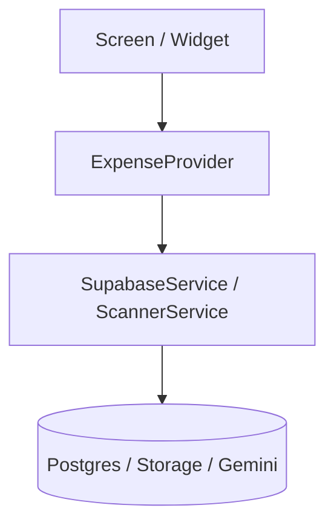

# 📋 [Feature/Update Title] — Implementation Plan

> **Status**: [DRAFT | UNDER REVIEW | APPROVED]  
> **Author**: Antigravity AI Agent & Engineering Team  
> **Target Release / Module**: [e.g. Analytics / Category / Keypad / Receipt OCR]

---

## 🎯 1. Executive Summary & Problem Statement
*Brief summary of the requested feature, update, or bug fix and why it is needed.*

---

## 💡 2. Product Knowledge & User Experience
*Detailed explanation of the product behavior from a user and business perspective.*

### 2.1 User Personas & Use Cases
- **Target User**: [Who is using this feature?]
- **Primary Flow**: [Step 1 -> Step 2 -> Step 3]
- **Alternative / Edge Case Flows**: [Offline mode, cancelled action, empty states]

### 2.2 UI & UX Specifications
- **Visual Design**: [Theme tokens, color accents, typography, spacing]
- **Interactive Elements**: [Buttons, gestures, micro-animations, keyboard interactions]
- **Feedback & States**: [Loading shimmer, error banners, success confirmations]

### 2.3 Product Impact & Backward Compatibility
- **Existing User Data**: [Will any existing transactions/categories/settings be affected?]
- **Demo Mode vs Supabase**: [Behavior in Local Mock Demo vs live Supabase backend]

---

## ⚙️ 3. Technical Approach & Architecture
*Concrete engineering design, data flows, and code modifications.*

### 3.1 Architectural Impact

### 3.2 Files to Modify / Create
| Action | File Path | Responsibility |
| :--- | :--- | :--- |
| `[NEW]` / `[MODIFY]` | `lib/...` | [Short description of changes] |

### 3.3 State Management & Data Mutations
- Methods to add/modify in `ExpenseProvider`.
- Model serialization updates (`toJson` / `fromJson`).
- Schema migrations or RLS policy additions.

### 3.4 Error Handling & Edge Cases
- Network timeout handling.
- Input validation (e.g. negative numbers, empty strings, date ranges $> today$).

---

## 🧪 4. Automated Unit Testing Plan
*Every update must have unit tests per `.agents/rules/mandatory-unit-tests.md`.*

| Test File | Target Class / Function | Test Scenarios |
| :--- | :--- | :--- |
| `test/unit/...` | `...` | [Success case, failure case, edge cases] |

---

## 🗺️ 5. Impact Mapping & Dependency Trace
- Downstream components touched in `IMPACT-MAPPING.md`.
- Required updates to `IMPACT-MAPPING.md` upon completion.

---

## 🚦 6. User Review & Approval Gate
- [ ] User feedback reviewed and incorporated.
- [ ] Explicit user approval received before coding starts.
