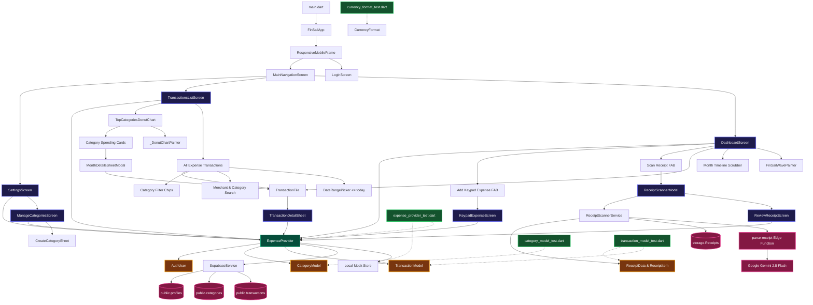

# 🗺️ Fin Sail — Comprehensive Impact Mapping & Dependency Matrix

> **Living Architecture Document**: Updated upon every realized application update per `.agents/skills/impact-mapping/SKILL.md`.  
> **Last Updated**: 2026-10-25

---

## 📌 1. Visual Architecture & Dependency Graph

The Mermaid graph below details how every layer of Fin Sail connects—from UI presentation down to Supabase storage, edge functions, and unit tests.



---

## 📊 2. Component & Downstream Blast Radius Matrix

When modifying any component, consult this table to assess which downstream dependencies are impacted:

| Component / Layer | File Path | Dependent UI / Logic | Impacted Backend / State | Unit Test Coverage |
| :--- | :--- | :--- | :--- | :--- |
| **`CategoryModel`** | `lib/models/category_model.dart` | Manage Categories, Overview Avatars, Analytics Filter Chips, Donut Slices, Keypad Pill, Review Chips, Detail Pill | `categories` table, `ExpenseProvider.categories` | `test/unit/category_model_test.dart` |
| **`TransactionModel`** | `lib/models/transaction_model.dart` | Overview List, All Expense Stream, Detail Sheet, Review Scanned Expense | `transactions` table, `items (JSONB)` | `test/unit/transaction_model_test.dart` |
| **`ReceiptData`** | `lib/models/receipt_data.dart` | `ReceiptScannerService`, `ReviewReceiptScreen` | Gemini Edge Function output, Storage `Receipts` | `test/unit/transaction_model_test.dart` |
| **`ExpenseProvider`** | `lib/providers/expense_provider.dart` | All screens, modals, and FAB buttons | Local Demo Mock, Supabase PostgREST sync | `test/unit/expense_provider_test.dart` |
| **`TopCategoriesDonutChart`** | `lib/widgets/top_categories_donut_chart.dart` | `TransactionsListScreen` (Tab 1), Category Modal | Provider monthly spend & category map | `test/widget_test.dart` |
| **`TransactionTile`** | `lib/widgets/transaction_tile.dart` | `DashboardScreen`, `TransactionsListScreen`, `MonthDetailsSheetModal` | Category color accents, receipt flags | `test/widget_test.dart` |
| **`CurrencyFormat`** | `lib/utils/currency_format.dart` | All price displays, cards, keypad, and donut chart | `NumberFormat` localization | `test/unit/currency_format_test.dart` |
| **`SupabaseService`** | `lib/services/supabase_service.dart` | `ExpenseProvider` | Supabase Client, Auth, Storage, RLS | Covered via mock provider tests |

---

## 🧪 3. Unit Test Coverage Matrix

Every module in Fin Sail is mapped to automated unit tests:

| Module / Area | Test File | Coverage Details | Verification Command |
| :--- | :--- | :--- | :--- |
| **Categories** | `test/unit/category_model_test.dart` | 10 default categories, vibrant color defaults, hex parsing, color fallback, vector icon resolution, `toJson`/`fromJson` | `flutter test test/unit/category_model_test.dart` |
| **Currencies & Formats** | `test/unit/currency_format_test.dart` | IDR (`Rp 1.152.000`), USD (`$1,152.00`), EUR, GBP, zero amounts, negative numbers | `flutter test test/unit/currency_format_test.dart` |
| **Transactions & Receipts** | `test/unit/transaction_model_test.dart` | Expense transaction serialization, receipt flags, itemized line items list, confidence calculation | `flutter test test/unit/transaction_model_test.dart` |
| **Expense State & Providers** | `test/unit/expense_provider_test.dart` | Mock data seeding, month-over-month trend % delta, add/edit/delete transactions, custom category creation & default protection | `flutter test test/unit/expense_provider_test.dart` |
| **App Smoke Test** | `test/widget_test.dart` | Material app bootstrap & theme initialization | `flutter test test/widget_test.dart` |

---

## 🔄 4. Update Protocol

Whenever changes to Fin Sail are realized:
1. Identify if new components, state handlers, or models were introduced.
2. Update the Mermaid graph in Section 1.
3. Update the Blast Radius Matrix in Section 2.
4. Add new test scenarios in Section 3 and execute:
   ```bash
   $HOME/flutter/bin/flutter test
   bash .agents/skills/impact-mapping/scripts/run_graphify.sh
   ```
